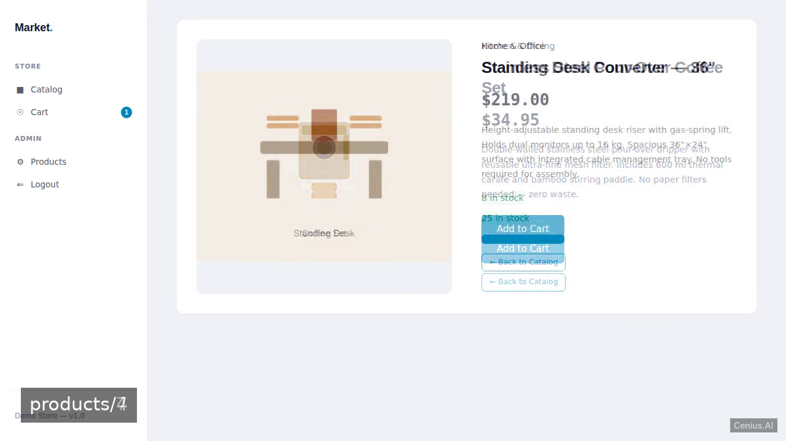
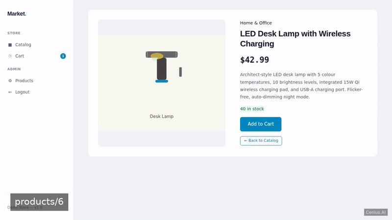
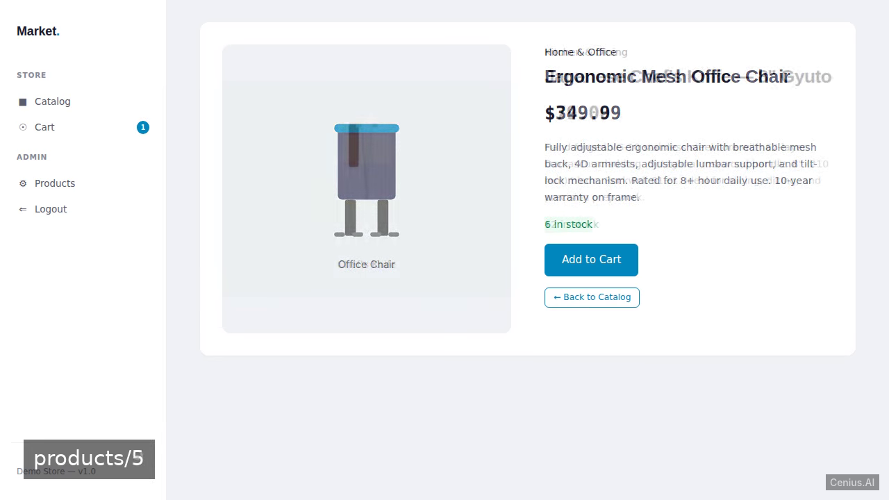
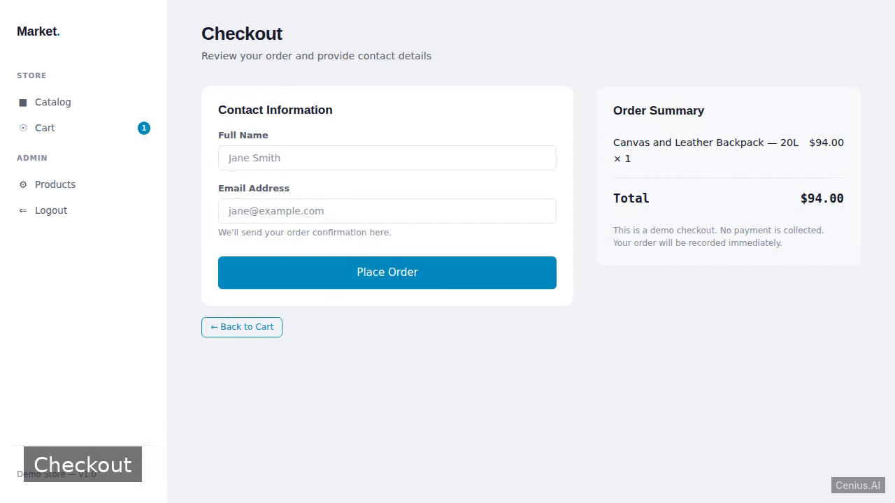

# Rails E-Commerce Storefront — Ruby on Rails e-commerce storefront reference implementation

**Rails E-Commerce Storefront** is a free, open-source e-commerce storefront built with Ruby on Rails. A self-contained Ruby on Rails 7 e-commerce storefront with product catalog, shopping cart, checkout, and admin product management. Run it locally, deploy it as a self-hosted e-commerce storefront, or [remix it on cenius.ai](https://cenius.ai/marketplace/p/rails-e-commerce-storefront?ref=gh&utm_campaign=rails-e-commerce-storefront) to make it your own — the whole application (code, design, seeded demo data) ships in this repository under the Apache-2.0 license.

[](LICENSE)  [](https://cenius.ai)

[](https://cenius.ai/marketplace/p/rails-e-commerce-storefront?ref=gh&utm_campaign=rails-e-commerce-storefront)

> **▶ [Open & edit in cenius.ai](https://cenius.ai/marketplace/p/rails-e-commerce-storefront?ref=gh&utm_campaign=rails-e-commerce-storefront)** — one click to an editable workspace: describe changes in plain English, get an instant preview, one-click deploy and host. Modifications made on the platform come with full rebrand & relicense rights.

_Local clone? See [Quick start](#quick-start) below. cenius.ai is the zero-setup path._

## Demo





▶ **[Watch the full demo video](https://cenius.ai/marketplace/p/rails-e-commerce-storefront?ref=gh&utm_campaign=rails-e-commerce-storefront)** — the complete walkthrough, playing on the project's cenius.ai page · [MP4 file](.github/media/demo.mp4)

## Screenshots

  

## Features

- Product Listing (Index Grid)
- Product Detail Page
- Add to Cart
- Shopping Cart View
- Checkout
- Admin Product Management
- Demo Data Seeding
- Admin Authentication

## Quick start

```bash
./install.sh   # installs dependencies + seeds demo data
```

See [`INSTALL.md`](INSTALL.md) for full setup and usage instructions.

## Usage guide

Once the application is running, open your browser to `http://localhost:3000`.

### Storefront

#### Browse Products

- The home page displays a grid of products, organized by category.
- Click any product to view its detail page, showing name, description, price, image, and stock availability.

#### Shopping Cart

- On a product detail page, click **Add to Cart** to place the item in your session-based cart.
- Access your cart anytime via the navigation link (e.g., `/cart`). The cart page lists items, quantities, and allows removal.

#### Checkout

- From the cart, proceed to checkout at `/orders/new`. Fill in your contact and shipping details, then submit the form.
- After successful submission, you'll see an order confirmation page (`/orders/:id`) with your order summary and line items.

### Admin Panel

- Navigate to `/admin/login` to access the admin login page.
- Enter the admin credentials (see seeds or create via console).
- Once logged in, you'll be directed to the admin products list.

#### Managing Products

- **List** all products (`/admin/products`). Click a product name to edit.
- **Create** a new product by clicking "New Product" and filling the form (name, description, price, image URL, stock, category).
- **Edit** a product: update fields and save.
- **Delete** a product: click the delete button on the list.

### API / Manual Requests (optional)

If you prefer to interact programmatically, here are the key endpoints:

```bash
## List products
curl http://localhost:3000/products

## View a product (replace 1 with id)
curl http://localhost:3000/products/1

_Full guide: [`USAGE.md`](USAGE.md)_

## Architecture

Ruby on Rails application, delivered as a complete, runnable project (1708 files). Top-level layout: `app/`, `bin/`, `config/`, `db/`, `lib/`, `log/`, `public/`, `storage/`. `install.sh` provisions dependencies and seeds demo data, so the app boots with something to show. Setup details live in [`INSTALL.md`](INSTALL.md).

## FAQ

### What does it take to self-host Rails E-Commerce Storefront?

Everything you need ships in this repo: clone it, run `./install.sh` to install dependencies and seed demo data, then follow [`INSTALL.md`](INSTALL.md) to start it. No external services required.

### Is Rails E-Commerce Storefront free for commercial use?

Yes. The code is Apache-2.0-licensed — use it, modify it, and ship it commercially. See [LICENSE](LICENSE).

### How do I make Rails E-Commerce Storefront my own brand?

Absolutely. [Open it on cenius.ai](https://cenius.ai/marketplace/p/rails-e-commerce-storefront?ref=gh&utm_campaign=rails-e-commerce-storefront) and remix it there — platform modifications come with full rebrand and relicense rights over your derivative, so the result is entirely yours.

### Is there a no-code way to modify Rails E-Commerce Storefront?

Open it on [cenius.ai](https://cenius.ai/marketplace/p/rails-e-commerce-storefront?ref=gh&utm_campaign=rails-e-commerce-storefront) and describe the changes you want in plain English — the platform modifies the app and gives you a new, downloadable build.

### What is Rails E-Commerce Storefront built with?

Rails E-Commerce Storefront is a Ruby on Rails application — and this repository holds the complete, runnable source, not a stripped-down sample. Highlights include product Listing (Index Grid).

## License & rebranding

Released under the [Apache License 2.0](LICENSE) (© 2026 Cenius AI) — free for personal and commercial use. The Cenius name/logo are trademarks (see NOTICE).

**Need a customized version?** [Remix this app on cenius.ai](https://cenius.ai/marketplace/p/rails-e-commerce-storefront?ref=gh&utm_campaign=rails-e-commerce-storefront) — modifications made on the platform come with **full rebrand & relicense rights** over your derivative.

## Built with cenius.ai

This entire application — code, design, seeded demo data — was generated on **[cenius.ai](https://cenius.ai)** from a plain-English description.

- 🚀 [Build your own app on cenius.ai](https://cenius.ai)
- 🎛️ [Remix Rails E-Commerce Storefront on the marketplace](https://cenius.ai/marketplace/p/rails-e-commerce-storefront?ref=gh&utm_campaign=rails-e-commerce-storefront) — open it in a workspace, prompt for changes, and ship your own version.

More open-source apps: [the Cenius-ai catalog](https://github.com/Cenius-ai) · [showcase index](https://github.com/Cenius-ai/showcase)
